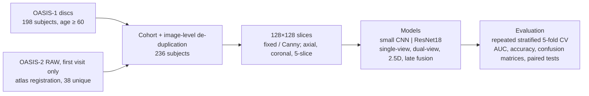
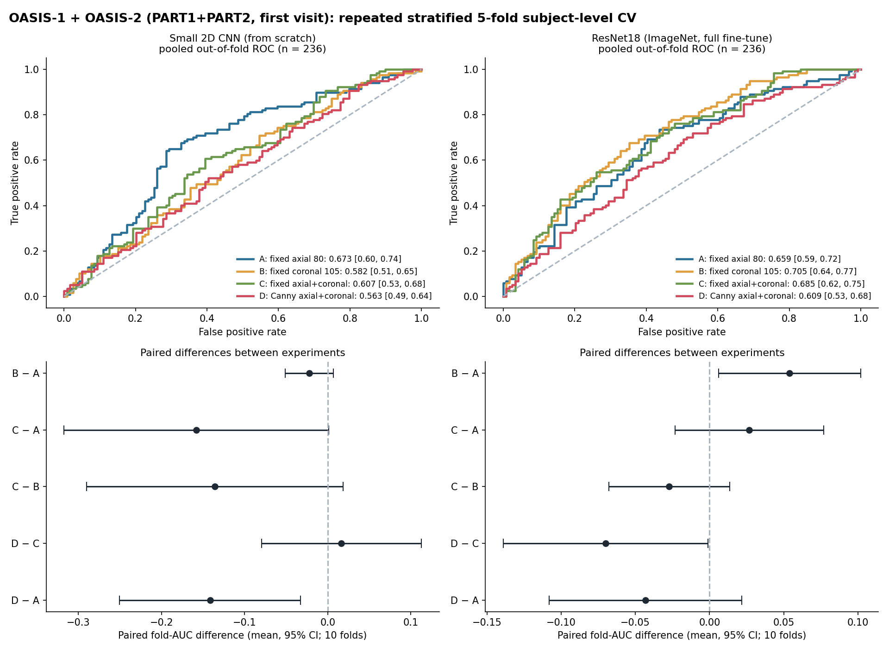
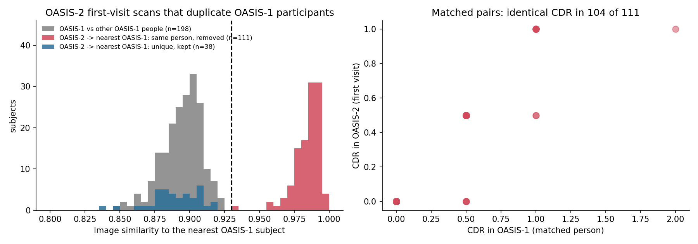
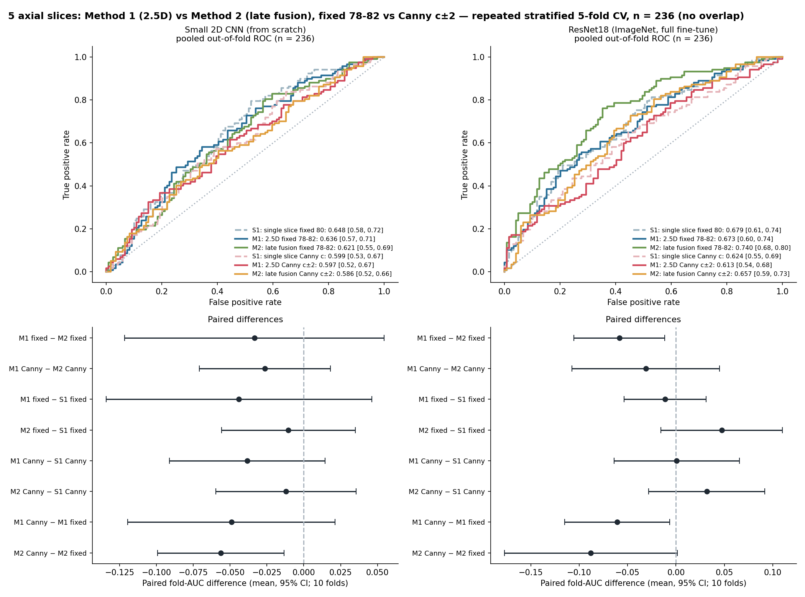
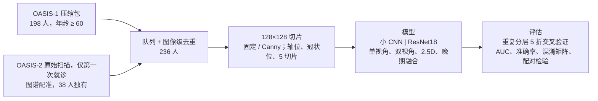

# OASIS-1 + OASIS-2: fixed vs Canny slices, axial / coronal / dual-view (team note)

> **中文版见文末 / Chinese version at the bottom:** [中文](#中文版)

## Key findings

1. **Single-slice MRI separates dementia (CDR>0) from no dementia only modestly:** cross-validated out-of-fold AUC ≈ **0.6–0.7** on 236 subjects (95% CI half-width ≈ 0.06).
2. **ImageNet-pretrained ResNet18 beats the small CNN trained from scratch** (AUC 0.61–0.74 vs 0.56–0.67; the small CNN mostly predicts "no dementia" at threshold 0.5).
3. **Canny-selected slices bring no benefit:** lowest or near-lowest in every comparison (the rule picks cerebellum slices). The best-powered pair is only suggestive (ΔAUC −0.088, p = 0.064). Fusing several slices/views and MRI-specific data augmentation gave no reliable gain either.
4. **OASIS-2 shares participants with OASIS-1:** 111 of the 149 first-visit OASIS-2 subjects are the same people as OASIS-1 participants (image similarity 0.95–0.997). A naive merge inflates AUC to 0.85–0.90 (identity leakage); after removing them only **38 new subjects** remain (**236** in total).
5. **Best setting:** ResNet18, late fusion of the fixed axial slices 78–82 (AUC 0.74, accuracy 0.67) — selected among many settings, so optimistic. **Not a diagnostic tool.**









> **Notebook outputs are stripped.** The notebooks in this repository have their outputs removed on commit (they would contain images and per-subject tables from OASIS participants), so GitHub shows code but no results. Run them locally after obtaining the data, or look at the figures and tables in `results/`.

## Question and experiments

**Question.** Can a 2D network detect dementia (CDR>0 vs CDR=0) from single MRI slices, and does the slice choice matter?

**Experiments (same subjects, folds, seeds, hyper-parameters)**

| | Axial | Coronal | Network |
|---|---|---|---|
| A | fixed (80) | – | single-view |
| B | – | fixed (105) | single-view |
| C | fixed (80) | fixed (105) | dual-view |
| D | Canny | Canny | dual-view |

Models: small 2D CNN (from scratch) and ImageNet-pretrained ResNet18 (full fine-tune). Evaluation: repeated stratified 5-fold CV (2 repeats), subject level, stratified by dataset × label.

## Data
- **OASIS-1** (age ≥ 60): 198 subjects (98 CDR=0 / 100 CDR>0).
- **OASIS-2** (PART1 + PART2, **first visit only**): 150 subjects → 149 registered to atlas space (1 failed QC) → **111 are the same people as OASIS-1 participants and were removed** → **38 unique** (21 / 17).
- **Final cohort: 236 subjects.**

> **Data-overlap warning.** Different IDs ≠ different people. 75% of the OASIS-2 first-visit subjects have a near-identical scan in OASIS-1 (image similarity 0.95–0.997 vs ≤ 0.92 between different OASIS-1 people; same sex/age/eTIV, same CDR in 104/111 pairs). Keeping them gave a spurious AUC of 0.85–0.90. All results from the OASIS-1 + OASIS-2 runs *before* de-duplication are in folders named `*_LEAKED_overlap` (**local only, not in this repository**) and **must not be used**. See `results/oasis_overlap_check.png`.

## Final results (236 subjects, pooled out-of-fold AUC, 95% bootstrap CI)

| | Small CNN | ResNet18 |
|---|---|---|
| A fixed axial 80 | 0.673 (0.60–0.74) | 0.659 (0.59–0.72) |
| B fixed coronal 105 | 0.582 (0.51–0.65) | 0.705 (0.64–0.77) |
| C fixed axial + coronal | 0.607 (0.53–0.68) | 0.685 (0.62–0.75) |
| D Canny axial + coronal | 0.563 (0.49–0.64) | 0.609 (0.53–0.68) |

- Modest discrimination overall (AUC ≈ 0.6–0.7); most differences are within noise (CI half-width ≈ 0.06).
- Canny-selected slices are lowest for both models (they sit in the cerebellum/posterior fossa).
- A second view does not clearly beat the best single view (ResNet18: C − A = +0.03, CI −0.02…+0.08).
- Only nominal positive paired difference: ResNet18 B − A = +0.054 (CI 0.006–0.102) – treat as a hypothesis.
- The small CNN mostly predicts CDR=0 at threshold 0.5 (poor calibration) – compare by AUC.

## 5-slice comparison (Method 1: 2.5D vs Method 2: late fusion; fixed 78–82 vs Canny c±2)
Same 236-subject cohort and folds. ResNet18: late fusion on fixed slices is best (AUC 0.740, CI 0.68–0.80) vs 0.673 (2.5D) and 0.679 (single slice); small CNN: no difference (0.59–0.65). Fixed beats Canny everywhere. Details: `results/five_slice/summary_en.md`, `five_slice_results.png`.

## Mean-pooling trial (late fusion with mean pooling vs 2.5D; fixed 78–82 vs Canny c±2)
No-overlap cohort (236), repeated stratified 5-fold CV. ResNet18 accuracy: mean pooling 0.661 (fixed) / 0.661 (Canny) vs 2.5D 0.623 / 0.555 vs concat 0.669 / 0.619. Mean pooling ≥ 2.5D in all cells (only ResNet18-Canny AUC clearly > 0: +0.078, CI 0.014–0.142); ≈ concatenation. Notebook: `notebooks/OASIS_5slice_meanpool_trial.ipynb`; tables/figures: `results/meanpool/`.

## Best model vs the same model with Canny slices (teacher-style notebook)
`notebooks/OASIS_best_model_vs_canny.ipynb`: ResNet18 late fusion (concat) on fixed 78–82 (AUC 0.740, acc 0.669) vs identical model on Canny c±2 (AUC 0.657, acc 0.619); paired AUC difference −0.088 (95% CI −0.177…+0.001, p = 0.064): suggestive, not conclusive. Code follows the course notebooks (explicit loop, checkpoint file, early stopping, torchmetrics, Grad-CAM); fold-0 results reproduce the cross-validation exactly.

## MRI data augmentation and square-padded axial slices (best model: ResNet18, late fusion by concatenation, fixed 78–82)
- **Aspect ratio:** axial slices (208 × 176) used to be resized straight to 128 × 128 (squashed by ~18%); now zero-padded to 208 × 208 first. No reliable effect: fixed 0.740 → 0.726 (paired Δ −0.009, p = 0.82), Canny 0.657 → 0.688 (Δ +0.027, p = 0.43). The Canny-selected slice changed for 56% of subjects.
- **Augmentation** (training only, one parameter set per subject for all 5 slices; same folds/seeds): rotation ±5° baseline vs G (rotation ±10°, shift ±5%, scale ±5%), I (+ bias field, gamma, noise, blur) and GI. None helped (Δ AUC vs baseline: G −0.02…−0.03, I −0.04…−0.05, GI +0.00…−0.05); intensity augmentation was slightly worse in both runs (p = 0.037 once, not conclusive with six comparisons).
- Details: `results/augmentation_square/summary_en.md`. The other experiments were **not** re-run on the square-padded slices. Slice axis / orientation / index checks: `scripts/verify_slices.py`.

## Glossary

| Term | Meaning |
|---|---|
| **CDR** | Clinical Dementia Rating. We use **CDR>0 (dementia / impairment) vs CDR=0**; this is a clinical rating, not a pathology-confirmed Alzheimer's diagnosis. |
| **Fixed slice** | A slice at a pre-set position of the atlas-registered volume (axial 80, coronal 105, or axial 78–82). |
| **Canny-selected slice** | The slice with the most Canny edge pixels within a search range (axial 50–110). Needs no labels; it tends to pick the cerebellum. |
| **2.5D** | Several neighbouring slices stacked as the input channels of one 2D network (early fusion). |
| **Late fusion** | Each slice goes through the same encoder separately; the features are combined afterwards (concatenation or mean pooling). |
| **Mean pooling** | Element-wise average of the per-slice feature vectors (order-independent, no extra parameters). |
| **Fine-tuning / pretrained** | Starting from ImageNet weights and updating all layers with a small learning rate. |
| **Repeated stratified 5-fold CV** | Subject-level 5-fold cross-validation repeated twice, stratified by dataset × label; every subject is tested once per repeat. |
| **Out-of-fold (pooled) AUC** | ROC-AUC of the predictions each subject received when it was in a test fold (averaged over repeats), with a bootstrap CI over subjects. |
| **Paired difference** | Difference of the per-fold AUCs of two settings on the *same* folds (mean, 95% t-interval, Wilcoxon p). |
| **Youden's J threshold** | Threshold maximising sensitivity + specificity − 1; here chosen on the validation split, never on the test fold. |
| **T88 / atlas space** | All volumes share one 176×208×176 grid (1 mm), so a slice index means the same anatomy in every subject. |
| **Grad-CAM** | Heat-map of the image regions that increased the class score (a sanity check, not evidence of pathology). |
| **LEAKED / overlap** | Results from the merged OASIS-1 + OASIS-2 data before removing duplicated people — invalid. |

### Names used in the results

| Name | Meaning | Where |
|---|---|---|
| **A, B, C, D** | final experiments: A fixed axial 80; B fixed coronal 105; C fixed axial 80 + coronal 105 (dual-view); D Canny axial + Canny coronal (dual-view) | `results/final_cv`, `results/dual_view` |
| **S1** | single-slice reference (fixed 80 or Canny c) | `results/five_slice` |
| **M1 (2.5D)** | 5 slices stacked as input channels | `results/five_slice` |
| **M2** | late fusion by **concatenation**, shared encoder | `results/five_slice` |
| **M2-mean** | late fusion by **mean pooling** | `results/meanpool` |
| **fixed 78–82** | the 5 consecutive axial slices 78, 79, 80, 81, 82 | all 5-slice experiments |
| **Canny c±2** | the Canny-selected slice `c` and the 2 slices on each side | all 5-slice experiments |
| **Model A / Model B** | in `OASIS_best_model_vs_canny.ipynb`: A = fixed 78–82, B = Canny c±2 (same ResNet18 late fusion) | notebook |
| **baseline, G, I, GI** | augmentation arms: rotation ±5° / geometric / intensity / both | `results/augmentation*` |
| **squashed / square-padded** | axial slice resized straight to 128×128 / padded to a square first | `results/square` |

## Reading order (what to look at, in the order the work was done)

| # | Step | Scripts (`scripts/`) | Results (`results/`) | Notebook |
|---|---|---|---|---|
| 1 | OASIS-1 baseline: fixed vs Canny, small CNN | `build_cohort.py`, `oasis1_fixed_vs_canny.py` | `oasis1_comparison*` (`_mtl3`, `_slice100` came from team-mates' own variants, no script) | `OASIS1_fixed_vs_canny.ipynb` |
| 2 | ResNet18 + repeated CV on OASIS-1 | `cv_compare.py`, `cv_analyze.py`, `resnet18_fixed_vs_canny.py`, `make_report_image.py` | `cv`, `resnet18`, `resnet18_layer4` | – |
| 3 | Coronal slices, dual-view (OASIS-1 only) | `build_dual_slices.py`, `dual_view_cv.py`, `dual_view_analyze.py`, `dual_view_confusion.py` | `dual_view`, `coronal_index_hist.png` | – |
| 4 | OASIS-2 first-visit preprocessing (atlas registration) | `build_template.py`, `register_oasis2.py` | – | – |
| 5 | ❌ **INVALID – kept for the record:** merged OASIS-1 + OASIS-2 runs before de-duplication | `combined_*.py`, `single_split_experiments.py`, `single_split_resnet*.py` | not included (`*_LEAKED_overlap`) | – |
| 6 | Overlap detection, 236-subject cohort | `build_combined.py`, `dataset_audit.py`, `overlap_figure.py` | `oasis_overlap_check.png` | – |
| 7 | **Final experiments A–D** (repeated CV) | `oasis_lib.py`, `final_cv.py`, `final_analyze.py` | `final_cv` | `OASIS1_OASIS2_classification.ipynb` |
| 8 | 5 slices: 2.5D vs late fusion | `build_5slice.py`, `oasis_5slice.py`, `five_slice_cv.py`, `five_slice_analyze.py` | `five_slice` | – |
| 9 | Late fusion with mean pooling | `meanpool_cv.py`, `meanpool_analyze.py`, `meanpool_roc.py` | `meanpool` | `OASIS_5slice_meanpool_trial.ipynb` |
| 10 | Youden-J threshold (chosen on validation) | `youden_cv.py`, `youden_analyze.py` | `youden` | – |
| 11 | Single train/val/test split (no cross-validation) | `single_split_5slice.py`, `single_split_5slice_analyze.py`, `single_split_roc.py` | `single_split_5slice` | – |
| 12 | Top-5 confusion matrices | `top5_confusion.py` | `top5_confusion.*` | – |
| 13 | Best model vs the same model with Canny slices | `build_best_vs_canny_notebook.py` | – | `OASIS_best_model_vs_canny.ipynb` |
| 14 | Check slice axis / orientation / indices | `verify_slices.py` | – | – |
| 15 | Square-padded slices and data augmentation | `build_5slice_square.py`, `square_cv.py`, `square_vs_old.py`, `augment_cv.py`, `augment_analyze.py` | `square`, `augmentation`, `augmentation_square` | – |

Scripts under step 5 start with a note that they ran on a cohort that was later found to contain duplicated people; they cannot be re-run from this repository.

## Getting the data (local only — not in this repository)

OASIS data must not be redistributed, so **`data/`, all model weights and the invalidated `results/*_LEAKED_overlap/` are local only, not in this repository** (see `.gitignore`).

1. Register and download from <https://www.oasis-brains.org/>:
   - **OASIS-1 (cross-sectional):** the 12 disc archives `oasis_cross-sectional_disc1` … `disc12` and the clinical spreadsheet `oasis_cross-sectional-<hash>.xlsx`.
   - **OASIS-2 (longitudinal):** the RAW image archives `OAS2_RAW_PART1.tar` and `OAS2_RAW_PART2.tar` and the demographics spreadsheet `oasis_longitudinal_demographics-<hash>.xlsx`.
2. Put the files in these places (rename the two spreadsheets as shown; symlinks are fine):
   ```
   data/raw/oasis_cross-sectional_disc1.tar … disc12.tar     (use *.tar.gz if your archives are gzipped)
   data/raw/oasis_cross-sectional.xlsx                       (OASIS-1 spreadsheet, renamed)
   data/oasis2/raw/OAS2_RAW_PART1.tar, OAS2_RAW_PART2.tar
   data/oasis2/raw/oasis_longitudinal_demographics.xlsx      (OASIS-2 spreadsheet, renamed)
   ```
3. Extract only the files the scripts use (macOS `bsdtar` syntax; with GNU tar use `--wildcards` instead of `--include`). About 5 GB (OASIS-1) + 10 GB (OASIS-2) after extraction:
   ```bash
   mkdir -p data/extracted data/oasis2/extracted data/template/oasis1_unmasked
   # OASIS-1: atlas-registered, brain-masked volumes
   for f in data/raw/oasis_cross-sectional_disc*.tar; do
     tar -xf "$f" -C data/extracted --include '*_t88_masked_gfc.img' --include '*_t88_masked_gfc.hdr'; done
   # OASIS-1 disc 1 only: unmasked (skull-on) volumes, used to build the registration template
   tar -xf data/raw/oasis_cross-sectional_disc1.tar -C data/template/oasis1_unmasked --include '*_t88_gfc.img' --include '*_t88_gfc.hdr'
   # OASIS-2: first-visit (MR1) raw scans only
   for p in 1 2; do tar -xf data/oasis2/raw/OAS2_RAW_PART$p.tar -C data/oasis2/extracted --include "OAS2_RAW_PART$p/OAS2_*_MR1/RAW/mpr-*.nifti.*"; done
   ```

### Layout
```
data/                (LOCAL ONLY, not in the repository)
  raw/                 OASIS-1 archives + spreadsheet;  oasis2/raw/  OASIS-2 archives + demographics
  extracted/           OASIS-1 T88 volumes;  oasis2/extracted|registered/  OASIS-2 first-visit scans (raw / atlas space)
  template/            registration template and brain mask
  cohort/              OASIS-1 cohort (198)
  combined_full/       final cohort (236): combined_cohort.csv, combined_slices.npz, axial5_slices*.npz, oasis2_overlap_report.csv
notebooks/           course-template notebooks (outputs stripped)
scripts/             all code (see "Reading order"); oasis_lib.py and oasis_5slice.py hold the shared model/training code
results/             tables and figures per experiment (see "Reading order")
results/*_LEAKED_overlap/   (LOCAL ONLY) invalid runs with duplicated people – do not use
```

### Reproduce
```bash
cd scripts
python build_cohort.py                          # OASIS-1 cohort (age >= 60) -> data/cohort/
python build_template.py                        # skull-on T88 template + brain mask
python register_oasis2.py                       # OASIS-2 first visit -> atlas space (--workers 4; add --robust --only <ID> if QC fails)
python build_combined.py                        # 236-subject cohort, image-level de-duplication, fixed/Canny slices
python build_5slice.py                          # 5-slice stacks
python final_cv.py cnn & python final_cv.py resnet   # experiments A-D, ~1 h on CPU
python final_analyze.py && python overlap_figure.py
python build_notebook.py                        # then execute the notebook
```
Requires Python 3.10 with `torch torchvision scikit-learn nibabel SimpleITK opencv-python-headless(4.11) pandas scipy matplotlib openpyxl grad-cam torchmetrics` and `numpy<2`.

## Data citation and acknowledgement

This project uses data from the **Open Access Series of Imaging Studies (OASIS)**, provided under the OASIS data-use terms (no redistribution, no attempt to identify participants) — see <https://www.oasis-brains.org/>. Please cite:

- Marcus DS, Wang TH, Parker J, Csernansky JG, Morris JC, Buckner RL. Open Access Series of Imaging Studies (OASIS): cross-sectional MRI data in young, middle aged, nondemented, and demented older adults. *J Cogn Neurosci* 2007; 19(9):1498–1507. doi:10.1162/jocn.2007.19.9.1498
- Marcus DS, Fotenos AF, Csernansky JG, Morris JC, Buckner RL. Open Access Series of Imaging Studies: longitudinal MRI data in nondemented and demented older adults. *J Cogn Neurosci* 2010; 22(12):2677–2684. doi:10.1162/jocn.2009.21407

Acknowledgement (please check the current wording on the OASIS website): *Data were provided by OASIS-1: Cross-Sectional and OASIS-2: Longitudinal; Principal Investigators: D. Marcus, R. Buckner, J. Csernansky, J. Morris; P50 AG05681, P01 AG03991, P01 AG026276, R01 AG021910, P20 MH071616, U24 RR021382.*

**Note on the commit history.** The history was assembled after the work was finished, in the order in which the work was actually done. Commit timestamps therefore do not reflect when each step was performed. The final results are tagged `v1.0`.

---

# 中文版

> English version at the top of this file. 数字和结果与上面的英文版完全一致。

# OASIS-1 + OASIS-2：固定切片与 Canny 切片，轴位 / 冠状位 / 双视角（团队说明）

## 主要发现

1. **单切片 MRI 区分痴呆（CDR>0）与无痴呆的能力有限：** 在 236 人上的交叉验证折外 AUC 约 **0.6–0.7**（95% 置信区间半宽约 0.06）。
2. **ImageNet 预训练的 ResNet18 优于从零训练的小 CNN**（AUC 0.61–0.74 对 0.56–0.67；小 CNN 在 0.5 阈值下大多预测“无痴呆”）。
3. **Canny 选出的切片没有优势：** 在所有比较中都是最低或接近最低（该规则选到的是小脑层）。检验力最强的一对也只是有提示意义（AUC 差 −0.088，p = 0.064）。融合多张切片 / 多个视角，以及针对 MRI 的数据增强，也都没有可靠的提升。
4. **OASIS-2 和 OASIS-1 有重复的参与者：** OASIS-2 第一次就诊的 149 人里有 111 人和 OASIS-1 的参与者是同一个人（图像相似度 0.95–0.997）。直接合并会把 AUC 抬高到 0.85–0.90（身份泄漏）；去除后只新增 **38 人**（共 **236** 人）。
5. **最好的设置：** ResNet18，对固定轴位 78–82 层做晚期融合（AUC 0.74，准确率 0.67）——是从很多设置里挑出来的，所以偏乐观。**不是诊断工具。**



（关键图见上方英文部分：`results/final_cv/final_results.png`、`results/oasis_overlap_check.png`、`results/five_slice/five_slice_results.png`。）

> **notebook 的输出已去除。** 本仓库的 notebook 在提交时去掉了输出（否则会包含 OASIS 参与者的图像和逐人表格），所以 GitHub 上只能看到代码，看不到结果。请拿到数据后在本地运行，或查看 `results/` 里的图和表。

## 问题与实验

**问题。** 2D 网络能否仅凭单张 MRI 切片检测痴呆（CDR>0 对 CDR=0），切片的选择是否重要？

**实验（受试者、折、随机种子、超参数都相同）**

| | 轴位 | 冠状位 | 网络 |
|---|---|---|---|
| A | 固定（80） | – | 单视角 |
| B | – | 固定（105） | 单视角 |
| C | 固定（80） | 固定（105） | 双视角 |
| D | Canny | Canny | 双视角 |

模型：小型 2D CNN（从零训练）和 ImageNet 预训练的 ResNet18（全部层微调）。评估：重复分层 5 折交叉验证（重复 2 次），按受试者划分，按“数据集 × 标签”分层。

## 数据
- **OASIS-1**（年龄 ≥ 60）：198 人（98 个 CDR=0 / 100 个 CDR>0）。
- **OASIS-2**（PART1 + PART2，**只用第一次就诊**）：150 人 → 149 人配准到图谱空间（1 人配准质检失败）→ **其中 111 人和 OASIS-1 里的参与者是同一个人，已去除** → **38 人独有**（21 / 17）。
- **最终队列：236 人。**

> **数据重叠警告。** ID 不同不等于人不同。OASIS-2 第一次就诊的受试者里有 75% 在 OASIS-1 中有几乎相同的扫描（图像相似度 0.95–0.997，而 OASIS-1 内部不同人之间 ≤ 0.92；性别、年龄、eTIV 相同，111 对中 104 对 CDR 相同）。保留它们会得到虚假的 AUC 0.85–0.90。所有去重之前的 OASIS-1 + OASIS-2 运行结果都放在名为 `*_LEAKED_overlap` 的文件夹里（**仅本地，不在本仓库中**），**不可使用**。见 `results/oasis_overlap_check.png`。

## 最终结果（236 人，汇总折外 AUC，95% 自助法置信区间）

| | 小 CNN | ResNet18 |
|---|---|---|
| A 固定轴位 80 | 0.673（0.60–0.74） | 0.659（0.59–0.72） |
| B 固定冠状位 105 | 0.582（0.51–0.65） | 0.705（0.64–0.77） |
| C 固定轴位 + 冠状位 | 0.607（0.53–0.68） | 0.685（0.62–0.75） |
| D Canny 轴位 + 冠状位 | 0.563（0.49–0.64） | 0.609（0.53–0.68） |

- 整体区分能力有限（AUC ≈ 0.6–0.7），大多数差异在噪声范围内（置信区间半宽 ≈ 0.06）。
- 两个模型上，Canny 选出的切片都是最低的（它们位于小脑 / 后颅窝）。
- 第二个视角并不明确优于最好的单视角（ResNet18：C − A = +0.03，置信区间 −0.02…+0.08）。
- 名义上唯一为正的配对差异：ResNet18 的 B − A = +0.054（置信区间 0.006–0.102）——只能当作假设。
- 小 CNN 在 0.5 阈值下大多预测 CDR=0（概率校准差）——应按 AUC 比较。

## 5 切片对比（方法 1：2.5D 对方法 2：晚期融合；固定 78–82 对 Canny c±2）
同样的 236 人队列和折。ResNet18：固定切片的晚期融合最好（AUC 0.740，置信区间 0.68–0.80），2.5D 为 0.673，单切片为 0.679；小 CNN：没有差别（0.59–0.65）。固定切片在所有设置下都优于 Canny。详情：`results/five_slice/summary_en.md`、`five_slice_results.png`。

## 均值池化试验（均值池化晚期融合对 2.5D；固定 78–82 对 Canny c±2）
无重叠队列（236 人），重复分层 5 折交叉验证。ResNet18 准确率：均值池化 0.661（固定）/ 0.661（Canny），2.5D 为 0.623 / 0.555，拼接为 0.669 / 0.619。均值池化在所有格子里都不低于 2.5D（只有 ResNet18-Canny 的 AUC 明显大于 0：+0.078，置信区间 0.014–0.142）；与拼接基本相当。notebook：`notebooks/OASIS_5slice_meanpool_trial.ipynb`；表格和图：`results/meanpool/`。

## 最好模型与换用 Canny 切片的同一模型（课程风格 notebook）
`notebooks/OASIS_best_model_vs_canny.ipynb`：固定 78–82 的 ResNet18 晚期融合（拼接）（AUC 0.740，准确率 0.669）对完全相同的、使用 Canny c±2 的模型（AUC 0.657，准确率 0.619）；AUC 配对差 −0.088（95% 置信区间 −0.177…+0.001，p = 0.064）：有提示意义，但不能下结论。代码遵循课程 notebook 的写法（显式训练循环、检查点文件、提前停止、torchmetrics、Grad-CAM）；第 0 折的结果与交叉验证完全一致。

## MRI 数据增强和补成正方形的轴位切片（最好模型：ResNet18，拼接晚期融合，固定 78–82）
- **纵横比：** 轴位切片（208 × 176）原来直接缩放到 128 × 128（被压扁约 18%）；现在先补零到 208 × 208 再缩放。没有可靠的影响：固定 0.740 → 0.726（配对差 −0.009，p = 0.82），Canny 0.657 → 0.688（差 +0.027，p = 0.43）。56% 的受试者的 Canny 选层发生了变化。
- **数据增强**（只用于训练，每个受试者的 5 张切片共用一组随机参数；折和随机种子相同）：旋转 ±5° 的基线对比 G（旋转 ±10°、平移 ±5%、缩放 ±5%）、I（再加偏置场、伽马、噪声、模糊）和 GI。都没有帮助（AUC 相对基线的变化：G −0.02…−0.03，I −0.04…−0.05，GI +0.00…−0.05）；强度增强在两次实验里都略差（有一次 p = 0.037，在六次比较下不能下结论）。
- 详情：`results/augmentation_square/summary_en.md`。其他实验**没有**用补成正方形的切片重跑。切片的轴、方向和层号检查：`scripts/verify_slices.py`。

## 术语表

| 术语 | 含义 |
|---|---|
| **CDR** | 临床痴呆评定量表。我们用 **CDR>0（痴呆 / 有损害）对 CDR=0**；这是临床评分，不是病理确诊的阿尔茨海默病。 |
| **固定切片** | 在图谱配准后的体积里取预先设定位置的切片（轴位 80、冠状位 105，或轴位 78–82）。 |
| **Canny 选片** | 在搜索范围内（轴位 50–110）选 Canny 边缘像素最多的那一层。不需要标签；倾向于选到小脑。 |
| **2.5D** | 把相邻的几张切片叠成一个 2D 网络的输入通道（早期融合）。 |
| **晚期融合** | 每张切片分别经过同一个编码器，之后再合并特征（拼接或均值池化）。 |
| **均值池化** | 对每张切片的特征向量逐维取平均（与顺序无关，不增加参数）。 |
| **微调 / 预训练** | 从 ImageNet 权重出发，用较小的学习率更新所有层。 |
| **重复分层 5 折交叉验证** | 按受试者划分的 5 折交叉验证重复两次，按“数据集 × 标签”分层；每次重复里每个人被测试一次。 |
| **折外（汇总）AUC** | 每个人在测试折里得到的预测（对两次重复取平均）计算的 ROC-AUC，置信区间对受试者做自助抽样。 |
| **配对差** | 两种设置在**同样的折**上每折 AUC 的差（均值、95% t 区间、Wilcoxon p 值）。 |
| **Youden J 阈值** | 使“敏感度 + 特异度 − 1”最大的阈值；这里只在验证集上选，绝不用测试折。 |
| **T88 / 图谱空间** | 所有体积共用同一个 176×208×176（1 mm）网格，所以同一个层号在每个人身上对应相同的解剖位置。 |
| **Grad-CAM** | 标出提高类别得分的图像区域的热图（只是合理性检查，不是病理证据）。 |
| **LEAKED / 重叠** | 去除重复的人之前，合并 OASIS-1 + OASIS-2 的运行结果——无效。 |

### 结果中使用的名称

| 名称 | 含义 | 位置 |
|---|---|---|
| **A、B、C、D** | 最终实验：A 固定轴位 80；B 固定冠状位 105；C 固定轴位 80 + 冠状位 105（双视角）；D Canny 轴位 + Canny 冠状位（双视角） | `results/final_cv`、`results/dual_view` |
| **S1** | 单切片参照（固定 80 或 Canny c） | `results/five_slice` |
| **M1（2.5D）** | 5 张切片叠成输入通道 | `results/five_slice` |
| **M2** | **拼接**的晚期融合，共享编码器 | `results/five_slice` |
| **M2-mean** | **均值池化**的晚期融合 | `results/meanpool` |
| **固定 78–82** | 连续 5 张轴位切片 78、79、80、81、82 | 所有 5 切片实验 |
| **Canny c±2** | Canny 选出的切片 `c` 及其前后各 2 张 | 所有 5 切片实验 |
| **模型 A / 模型 B** | 在 `OASIS_best_model_vs_canny.ipynb` 里：A = 固定 78–82，B = Canny c±2（同一个 ResNet18 晚期融合） | notebook |
| **baseline、G、I、GI** | 增强各组：旋转 ±5° / 几何 / 强度 / 两者 | `results/augmentation*` |
| **压扁 / 补成正方形** | 轴位切片直接缩放到 128×128 / 先补成正方形再缩放 | `results/square` |

## 阅读顺序（按工作的先后顺序）

| # | 步骤 | 脚本（`scripts/`） | 结果（`results/`） | notebook |
|---|---|---|---|---|
| 1 | OASIS-1 基线：固定对 Canny，小 CNN | `build_cohort.py`、`oasis1_fixed_vs_canny.py` | `oasis1_comparison*`（`_mtl3`、`_slice100` 来自组员自己的版本，没有对应脚本） | `OASIS1_fixed_vs_canny.ipynb` |
| 2 | ResNet18 与 OASIS-1 上的重复交叉验证 | `cv_compare.py`、`cv_analyze.py`、`resnet18_fixed_vs_canny.py`、`make_report_image.py` | `cv`、`resnet18`、`resnet18_layer4` | – |
| 3 | 冠状位切片、双视角（只有 OASIS-1） | `build_dual_slices.py`、`dual_view_cv.py`、`dual_view_analyze.py`、`dual_view_confusion.py` | `dual_view`、`coronal_index_hist.png` | – |
| 4 | OASIS-2 第一次就诊的预处理（图谱配准） | `build_template.py`、`register_oasis2.py` | – | – |
| 5 | ❌ **无效，仅作记录：** 去重之前合并 OASIS-1 + OASIS-2 的运行 | `combined_*.py`、`single_split_experiments.py`、`single_split_resnet*.py` | 不在仓库中（`*_LEAKED_overlap`） | – |
| 6 | 重叠检测，236 人队列 | `build_combined.py`、`dataset_audit.py`、`overlap_figure.py` | `oasis_overlap_check.png` | – |
| 7 | **最终实验 A–D**（重复交叉验证） | `oasis_lib.py`、`final_cv.py`、`final_analyze.py` | `final_cv` | `OASIS1_OASIS2_classification.ipynb` |
| 8 | 5 切片：2.5D 对晚期融合 | `build_5slice.py`、`oasis_5slice.py`、`five_slice_cv.py`、`five_slice_analyze.py` | `five_slice` | – |
| 9 | 均值池化的晚期融合 | `meanpool_cv.py`、`meanpool_analyze.py`、`meanpool_roc.py` | `meanpool` | `OASIS_5slice_meanpool_trial.ipynb` |
| 10 | Youden J 阈值（在验证集上选） | `youden_cv.py`、`youden_analyze.py` | `youden` | – |
| 11 | 一次 train/val/test 划分（不做交叉验证） | `single_split_5slice.py`、`single_split_5slice_analyze.py`、`single_split_roc.py` | `single_split_5slice` | – |
| 12 | 前 5 名的混淆矩阵 | `top5_confusion.py` | `top5_confusion.*` | – |
| 13 | 最好模型与换用 Canny 切片的同一模型 | `build_best_vs_canny_notebook.py` | – | `OASIS_best_model_vs_canny.ipynb` |
| 14 | 检查切片的轴、方向和层号 | `verify_slices.py` | – | – |
| 15 | 补成正方形的切片与数据增强 | `build_5slice_square.py`、`square_cv.py`、`square_vs_old.py`、`augment_cv.py`、`augment_analyze.py` | `square`、`augmentation`、`augmentation_square` | – |

第 5 步的脚本开头都写有说明：它们在后来发现含有重复的人的队列上运行过，无法从本仓库重新运行。

## 怎么拿到数据（仅本地，不在本仓库中）

OASIS 数据不得再分发，所以 **`data/`、所有模型权重和作废的 `results/*_LEAKED_overlap/` 都是仅本地、不在本仓库中的**（见 `.gitignore`）。

1. 在 <https://www.oasis-brains.org/> 注册并下载：
   - **OASIS-1（横断面）：** 12 个压缩包 `oasis_cross-sectional_disc1` … `disc12`，以及临床表格 `oasis_cross-sectional-<hash>.xlsx`。
   - **OASIS-2（纵向）：** 原始图像压缩包 `OAS2_RAW_PART1.tar` 和 `OAS2_RAW_PART2.tar`，以及人口学表格 `oasis_longitudinal_demographics-<hash>.xlsx`。
2. 把文件放到下面的位置（两个表格按图示重命名；用软链接也可以）：
   ```
   data/raw/oasis_cross-sectional_disc1.tar … disc12.tar     （如果压缩包是 gzip 格式，用 *.tar.gz）
   data/raw/oasis_cross-sectional.xlsx                       （OASIS-1 表格，已重命名）
   data/oasis2/raw/OAS2_RAW_PART1.tar, OAS2_RAW_PART2.tar
   data/oasis2/raw/oasis_longitudinal_demographics.xlsx      （OASIS-2 表格，已重命名）
   ```
3. 只解压脚本用到的文件（macOS 的 `bsdtar` 写法；GNU tar 要把 `--include` 换成 `--wildcards`）。解压后约 5 GB（OASIS-1）加 10 GB（OASIS-2）：
   ```bash
   mkdir -p data/extracted data/oasis2/extracted data/template/oasis1_unmasked
   # OASIS-1：图谱配准、去颅骨的体积
   for f in data/raw/oasis_cross-sectional_disc*.tar; do
     tar -xf "$f" -C data/extracted --include '*_t88_masked_gfc.img' --include '*_t88_masked_gfc.hdr'; done
   # 仅 OASIS-1 的 disc1：未去颅骨（带颅骨）的体积，用来建立配准模板
   tar -xf data/raw/oasis_cross-sectional_disc1.tar -C data/template/oasis1_unmasked --include '*_t88_gfc.img' --include '*_t88_gfc.hdr'
   # OASIS-2：只要第一次就诊（MR1）的原始扫描
   for p in 1 2; do tar -xf data/oasis2/raw/OAS2_RAW_PART$p.tar -C data/oasis2/extracted --include "OAS2_RAW_PART$p/OAS2_*_MR1/RAW/mpr-*.nifti.*"; done
   ```

### 目录结构
```
data/                （仅本地，不在仓库中）
  raw/                 OASIS-1 压缩包和表格；  oasis2/raw/  OASIS-2 压缩包和人口学表
  extracted/           OASIS-1 的 T88 体积；  oasis2/extracted|registered/  OASIS-2 第一次就诊扫描（原始 / 图谱空间）
  template/            配准模板和脑掩模
  cohort/              OASIS-1 队列（198 人）
  combined_full/       最终队列（236 人）：combined_cohort.csv、combined_slices.npz、axial5_slices*.npz、oasis2_overlap_report.csv
notebooks/           课程模板格式的 notebook（输出已去除）
scripts/             全部代码（见“阅读顺序”）；oasis_lib.py 和 oasis_5slice.py 是共享的模型 / 训练代码
results/             每个实验的表格和图（见“阅读顺序”）
results/*_LEAKED_overlap/   （仅本地）含重复人的无效运行——不要使用
```

### 复现
```bash
cd scripts
python build_cohort.py                          # OASIS-1 队列（年龄 >= 60）-> data/cohort/
python build_template.py                        # 带颅骨的 T88 模板 + 脑掩模
python register_oasis2.py                       # OASIS-2 第一次就诊 -> 图谱空间（--workers 4；质检失败时加 --robust --only <ID>）
python build_combined.py                        # 236 人队列、图像级去重、固定 / Canny 切片
python build_5slice.py                          # 5 切片
python final_cv.py cnn & python final_cv.py resnet   # 实验 A–D，CPU 上约 1 小时
python final_analyze.py && python overlap_figure.py
python build_notebook.py                        # 然后执行 notebook
```
需要 Python 3.10，以及 `torch torchvision scikit-learn nibabel SimpleITK opencv-python-headless(4.11) pandas scipy matplotlib openpyxl grad-cam torchmetrics` 和 `numpy<2`。

## 数据引用与致谢

本项目使用了 **Open Access Series of Imaging Studies（OASIS）** 的数据，数据按 OASIS 的数据使用条款提供（不得再分发，不得试图识别参与者），见 <https://www.oasis-brains.org/>。请引用：

- Marcus DS, Wang TH, Parker J, Csernansky JG, Morris JC, Buckner RL. Open Access Series of Imaging Studies (OASIS): cross-sectional MRI data in young, middle aged, nondemented, and demented older adults. *J Cogn Neurosci* 2007; 19(9):1498–1507. doi:10.1162/jocn.2007.19.9.1498
- Marcus DS, Fotenos AF, Csernansky JG, Morris JC, Buckner RL. Open Access Series of Imaging Studies: longitudinal MRI data in nondemented and demented older adults. *J Cogn Neurosci* 2010; 22(12):2677–2684. doi:10.1162/jocn.2009.21407

致谢（请以 OASIS 官网当前的措辞为准）：*Data were provided by OASIS-1: Cross-Sectional and OASIS-2: Longitudinal; Principal Investigators: D. Marcus, R. Buckner, J. Csernansky, J. Morris; P50 AG05681, P01 AG03991, P01 AG026276, R01 AG021910, P20 MH071616, U24 RR021382.*

**关于提交历史的说明。** 提交历史是在工作全部完成后，按照实际工作的先后顺序整理出来的，因此提交时间不代表每一步实际完成的时间。最终结果已打上标签 `v1.0`。
