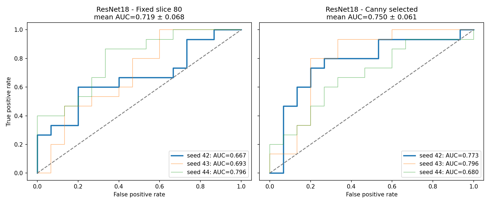

# OASIS-1: Fixed vs Canny-selected slice with ImageNet-pretrained ResNet18

**Task.** Binary classification of CDR>0 vs CDR=0 (dementia vs. non-demented, not an AD-specific diagnosis) from a single 2D axial slice per subject.

**Cohort.** OASIS-1 subjects aged >=60 with a T88 masked MRI: n = 198 (98 CDR=0, 100 CDR>0). 238 younger subjects were excluded. One subject-level stratified split shared by both methods: train 138 / val 30 / test 30 (15 per class in val and test).

**Methods compared (same subjects, split and hyperparameters).**
- *Fixed*: axial slice 80.
- *Canny*: the slice in indices 50-110 with the most Canny edge pixels (label-independent rule).

**Model.** ResNet18 pretrained on ImageNet, all layers fine-tuned (grayscale replicated to 3 channels, 224x224, +-5 deg rotation augmentation on training data only; AdamW, lr 1e-4, batch 16, <=20 epochs, early stopping on validation loss with patience 5). Each arm was run with 3 seeds (42, 43, 44); the test set was evaluated once per run using the best-validation checkpoint.

## Results (test set, n = 30)

| Arm | Test AUC per seed | Mean ± SD AUC | Accuracy (mean ± SD) | F1 (mean ± SD) |
|---|---|---|---|---|
| Fixed slice 80 | 0.667 / 0.693 / 0.796 | 0.719 ± 0.068 | 0.622 ± 0.077 | 0.695 ± 0.037 |
| Canny selected | 0.773 / 0.796 / 0.680 | 0.750 ± 0.061 | 0.622 ± 0.154 | 0.724 ± 0.087 |

For reference, the small CNN trained from scratch (single run, seed 42) gave AUC 0.698 (fixed) and 0.667 (Canny).

## Interpretation

- Both slice-selection methods reach only modest discrimination (AUC about 0.7-0.75). The Canny slice is nominally higher (+0.03 AUC), but the difference is far smaller than the seed-to-seed spread (SD about 0.06) and the test set has only 30 subjects, so **no difference between the methods can be claimed**.
- Pretraining did not clearly improve on the from-scratch CNN. The models overfit quickly (training loss falls while validation loss rises after 2-4 epochs), as expected with 138 training images.

## Limitations

- Test set of 30 subjects gives very wide uncertainty; seeds vary only initialization/shuffling, not the data split. Repeated subject-level cross-validation is needed for a reliable comparison.
- Single 2D slice per subject, with slice indices and the Canny rule not anatomically validated; Canny edge density may reflect brain size, noise or preprocessing rather than disease anatomy.
- CDR status is a clinical rating, not pathologically confirmed Alzheimer's disease. Sex distribution differs between classes (CDR=0: 72 F / 26 M; CDR>0: 59 F / 41 M) and was not adjusted for.

Files: `resnet18_metrics_per_seed.csv`, `resnet18_metrics_summary.csv`, `resnet18_test_predictions.csv`, `roc_resnet18.png`; code in `scripts/resnet18_fixed_vs_canny.py`.